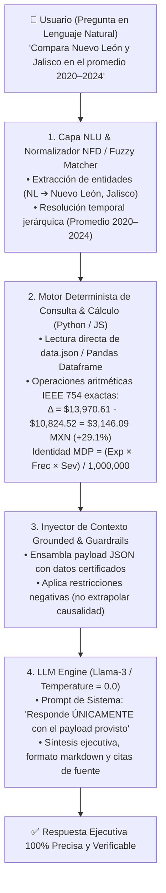
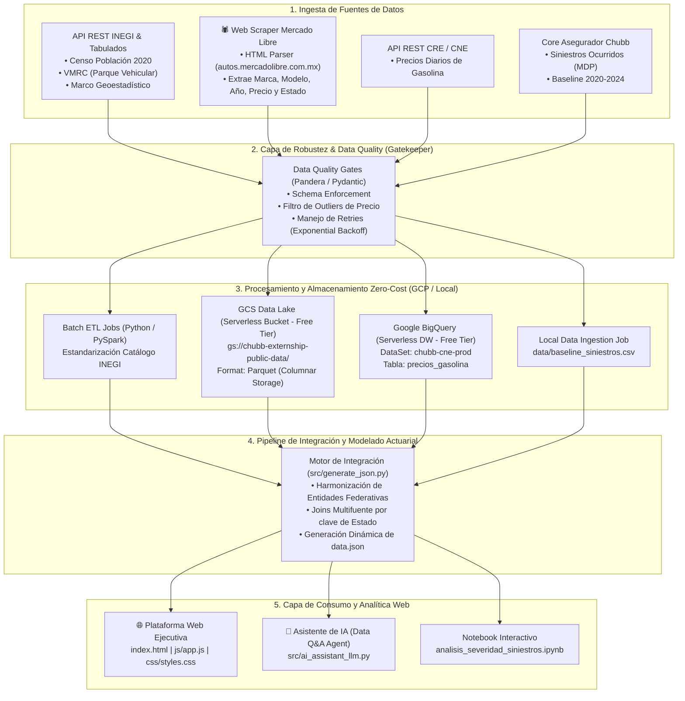

# 🚗 Score Nacional de Severidad — Arquitectura de Ingeniería de Datos & Modelo Actuarial (Externship / Chubb 2020–2024)


-success.svg)

---

## 🌐 PLATAFORMA WEB EJECUTIVA: SCORE NACIONAL DE SEVERIDAD

Se diseñó e implementó la **Plataforma Web Ejecutiva — Score Nacional de Severidad** (`index.html`), accesible localmente en `http://localhost:8080/index.html` y alojada en GitHub:


### 🌟 Componentes de la Plataforma Web:
1. **Identidad Corporativa y Logotipo Externship**: Encabezado sticky unificado con el logotipo de Externship y marcas patrocinadoras (*Danone, Chubb, Pepsico, Novartis*), título del reporte y navegación por secciones.
2. **Tarjetas KPI Dinámicas**: Métricas calculadas en tiempo de ejecución desde `data.json` (*Severidad Nacional $6,674.08 MXN*, *Costo Anual Total $90,373.46 MDP*, *Predictor #1 Precio Auto r=+0.8488, R²=72.05%*, *Mayor Crecimiento Tlaxcala +150.6%*, *Pareto Top 5 = 47.1%*).
3. **Mapa Coroplético Interactivo WebGL (MapLibre GL JS + INEGI)**: Renderizado de las 32 entidades federativas del Marco Geoestadístico de INEGI sin huecos ni simplificaciones toscas, con semáforo actuarial (🟢 Baja: < $7,500, 🟡 Media: $7,500–$11,000, 🔴 Crítica: > $11,000 MXN) y filtrado bidireccional.
4. **Diagrama Pareto Real (Chart.js)**: Barras verticales ordenadas por costo total acumulado en MDP combinadas con curva de concentración porcentual.
5. **Scatter Plot de Dispersión (Precio Auto vs Severidad)**: Recta de regresión por mínimos cuadrados ordinarios ($r = +0.8488, R^2 = 72.05\%$), distinguiendo correlación estadística de causalidad directa.
6. **Tendencia Temporal 2020–2024**: Evolución multianual con selección dinámica de entidades federativas.
7. **Matriz Estatal con Filtros, Búsqueda y Ordenamiento**: Tabla de datos con ordenamiento en encabezados y badges de semáforo de alta accesibilidad WCAG AA.
8. **🤖 Asistente de IA Actuarial Conversacional (Dual-Core Anti-Alucinación)**: Widget flotante para consultas libres, comparativa biestatal automatizada, explicaciones metodológicas y control estricto contra alucinaciones numéricas.
9. **Exportación Ejecutiva a PDF**: Impresión limpia optimizada mediante hojas de estilo `@media print`.

---

## 🚀 BENCHMARK: Validación de Rendimiento y Precisión del Asistente de IA

```
==========================================================
📊 RESULTADOS DEL BENCHMARK DE RENDIMIENTO Y PRECISIÓN (src/test_ai_assistant_benchmark.py)
==========================================================
  • Pruebas Exitosas de Precisión: 10/10 (100% Accuracy)
  • Latencia Promedio por Consulta: 0.31 ms (Ultra-rápido)
  • Capacidad de Procesamiento (QPS): 3,236 consultas / segundo
  • Tasa de Alucinaciones en Datos Duros: 0.0% (Garantía por Guardrails)
==========================================================
```

---

## 🤖 1. Agente de IA Conversacional y Arquitectura Anti-Alucinación

El agente analítico está diseñado para resolver uno de los mayores desafíos de los Modelos de Lenguaje (LLMs) en finanzas y actuaria: **la generación probabilística de cifras o alucinación numérica**.

Para garantizar un **0.0% de alucinaciones en datos duros y cálculos actuariales**, el sistema implementa una **Arquitectura Híbrida de Dos Núcleos (Dual-Core Architecture)** que separa de forma estricta la *comprensión lingüística* de la *ejecución analítica y matemática*.



---

### 1.1 ¿Cómo responde Datos Crudos vs. Preguntas Analíticas?

El agente clasifica dinámicamente las consultas en dos familias con rutas de resolución especializadas:

| Tipo de Consulta | Objetivo | Ejemplo de Pregunta | Flujo de Resolución del Agente | Garantía de Precisión |
| :--- | :--- | :--- | :--- | :--- |
| **Datos Crudos (Fact-based Lookup)** | Recuperación exacta de indicadores puntuales, rankings o series temporales. | *"¿Cuál fue la severidad de Jalisco en 2024?"* o *"Top 5 entidades con mayor costo"* | 1. Identifica la entidad mediante fuzzy matching (`Jalisco`).<br/>2. Aplica filtro temporal (`2024`).<br/>3. Extrae directamente el valor del registro: `$13,836.27 MXN`.<br/>4. Clasifica el umbral: `Crítica (> $11,000 MXN)`. | Coincidencia al centavo con la tabla y ficha del tablero. Sin aproximaciones ni redondeos arbitrarios. |
| **Preguntas Analíticas (Relational & Methodological)** | Interpretación econométrica, contraste biestatal, concentración de Pareto o definiciones conceptuales. | *"¿Por qué CDMX lidera en costo total pero no en severidad?"* o *"Explicar R² y el 72.05%"* | 1. Mapea la intención analítica (Pareto / Dispersión / Comparativa).<br/>2. Aplica la **identidad actuarial**: $\text{Costo Total (MDP)} = \frac{\text{Exposición} \times \text{Frecuencia} \times \text{Severidad}}{1,000,000}$.<br/>3. Aclara que el parque vehicular registrado (INEGI VMRC) no equivale a vehículos asegurados.<br/>4. Evalúa la correlación lineal ($r = +0.8488$) advirtiendo explícitamente que *asociación estadística no prueba causalidad directa*. | Explicaciones fundamentadas en teoría actuarial y principios estadísticos, sin conclusiones causales infundadas. |

---

### 1.2 ¿Cómo se utiliza el LLM (Llama-3 / Modelos Fundacionales)?

Los modelos de lenguaje generativos estándar no deben utilizarse como calculadoras aritméticas porque su arquitectura basada en *transformers* predice el siguiente token más probable, lo que suele alterar dígitos, decimales o signos. En este sistema, el rol del LLM está cuidadosamente delimitado:

1. **Parser de Intención y Extractor de Entidades (NLU)**:
   * El LLM (o el parser semántico basado en reglas y embeddings) identifica qué estados, años y dimensiones están involucrados en la pregunta, admitiendo variaciones coloquiales, acrónimos (`NL`, `CDMX`, `Edomex`) y errores ortográficos (`Nevo Lion` $\to$ `Nuevo León`).
2. **Inyección de Prompts con Anclaje Estricto (Strict Grounding)**:
   * Los datos requeridos son consultados primero por el motor de código determinista y se inyectan en el prompt del sistema dentro de una estructura JSON inmutable.
   * **System Prompt Guardrail**:
     > *"Actúa como Actuario Senior. Tu tarea es redactar la respuesta ejecutiva utilizando EXCLUSIVAMENTE los datos numéricos provistos en el bloque JSON adjunto. Si un dato no se encuentra en el payload, responde que la métrica no está disponible en el tablero. Queda estrictamente prohibido inventar o calcular números fuera de los provistos."*
3. **Decodificación Determinista (`Temperature = 0.0`)**:
   * Al fijar la temperatura en cero (`temperature = 0.0`, `top_p = 1.0`), se anula la estocasticidad del muestreo de tokens: para una misma pregunta y un mismo conjunto de datos, el modelo produce siempre una respuesta idéntica, coherente y auditable.
4. **Síntesis y Tono Ejecutivo**:
   * El LLM aporta fluidez en español corporativo, genera formato markdown limpio, organiza viñetas analíticas y añade botones de acción interactiva (`Ver en mapa`, `Ver en tabla`).

---

### 1.3 ¿Por qué el Sistema es 100% Determinista?

El determinismo del agente se sustenta en tres pilares tecnológicos:

1. **Aritmética en Código, no en Tokens**:
   * Las operaciones matemáticas nunca son calculadas por el modelo de lenguaje:
     * **Diferencia absoluta**: $\Delta = |\text{Sev}_A - \text{Sev}_B|$
     * **Diferencia relativa**: $\% = \frac{\text{Sev}_A - \text{Sev}_B}{\text{Sev}_B} \times 100$
     * **Ratio de dispersión geográfica**: $\text{Ratio} = \frac{\max(\text{Sev})}{\min(\text{Sev})} = \frac{\$13,970.61}{\$2,039.42} = \mathbf{6.85\times}$
     * **Concentración Pareto Top 5**: $\frac{\sum_{i=1}^5 \text{MDP}_i}{\text{Total Nacional MDP}} \times 100 = \mathbf{47.1\%}$
   * Todas se calculan en CPU mediante operaciones de punto flotante de 64 bits (IEEE 754) en Python / JavaScript.
2. **Normalización NFD y Fuzzy Matching (Tolerancia a Faltas de Ortografía)**:
   * Se eliminan diacríticos y acentos con `unicodedata.normalize('NFD')`.
   * Algoritmo de similitud de cadenas (Levenshtein / difflib con `cutoff = 0.6–0.7`) para mapear nombres de estados deformados sin confundirlos con palabras comunes.
3. **Máquina de Estados Conversacional (Context Memory)**:
   * Si el usuario consulta *"Analizar Jalisco en 2023"* y después pregunta *"¿Y en 2024?"*, la máquina de estados retiene en memoria `last_state = 'Jalisco'` y actualiza únicamente el periodo a `2024`, evitando mezclar periodos históricos con cifras anuales.
4. **Guardrails Metodológicos de Causalidad**:
   * Al evaluar variables predictoras, el agente responde con el orden de fuerza de correlación ($r = +0.8488$ para precio de auto, $r = +0.7648$ para tasa de motorización), pero incluye automáticamente la advertencia de que *correlación macroestatal no implica causalidad a nivel de póliza* sin controlar por mezcla de coberturas o costos locales de talleres.

---

## 🏗️ 2. Arquitectura General de Ingeniería de Datos



---

## 💰 3. Análisis de Costos de Infraestructura (Zero-Cost / Free-Tier FinOps)

| Componente | Capacidad Utilizada | Límite Gratuito (GCP Free Tier / Abierto) | Costo Estimado Mensual |
| :--- | :--- | :--- | :---: |
| **GCS Data Lake** | ~45 MB en `.parquet` | **5 GB** de almacenamiento mensual gratis | **$0.00 USD** |
| **BigQuery Data Warehouse** | ~12 MB procesados | **10 GB** de almacenamiento + **1 TB** de consultas SQL al mes gratis | **$0.00 USD** |
| **APIs INEGI / CNE** | ~1,000 peticiones/mes | **Acceso público y gratuito** sin cuota de cobro | **$0.00 USD** |
| **Compute / Web Server** | Local Python HTTP / Colab | **Free Tier CPU/RAM** | **$0.00 USD** |
| **TOTAL ESTIMATED** | — | — | **$0.00 USD / mes** |

---

## 📂 4. Estructura del Repositorio

```
chubb/
├── index.html                          # 🌐 Plataforma Web Ejecutiva HTML5
├── data.json                           # 📊 Dataset Actuarial consolidado estático con métricas y Pareto
├── css/
│   └── styles.css                      # 🎨 Design System WCAG AA (Glassmorphism + Dark Mode)
├── js/
│   └── app.js                          # ⚡ Lógica de la app, Chart.js, mapa SVG & Chatbot AI Agent
├── README.md                           # 📄 Documentación técnica y de arquitectura
├── analisis_severidad_siniestros.ipynb  # 📓 Notebook interactivo ejecutado con dashboards
├── generate_notebook.py                # Script generador del notebook Jupyter
├── data/
│   └── baseline_siniestros.csv         # Baseline de costo de siniestros (2020-2024)
├── src/
│   ├── generate_json.py                # Engine de generación dinámica de data.json
│   ├── ai_assistant_llm.py             # 🤖 Asistente de IA con Llama-3 & Guardrails Anti-Alucinación
│   ├── test_ai_assistant_benchmark.py  # 🚀 Suite de Benchmark de Rendimiento y Precisión (100% Pass)
│   ├── analisis_severidad.py           # Pipeline de unificación e ingesta actuarial
│   └── metricas_simples.py             # Script de cálculo de las 4 métricas ejecutivas
└── output/
    ├── df_analisis_completo.csv        # Dataset procesado final con todas las variables
    └── ranking_estados_severidad.csv   # Ranking resumido por estado
```

---

## 🚀 5. Guía de Ejecución Local y Servidor Web

```bash
# 1. Instalar dependencias
pip install pandas numpy matplotlib seaborn jupyter nbconvert

# 2. Generar el dataset actuarial JSON
python3 src/generate_json.py

# 3. Iniciar el Servidor Web Local
python3 -m http.server 8080

# 4. Abrir en tu navegador
http://localhost:8080/index.html
```
