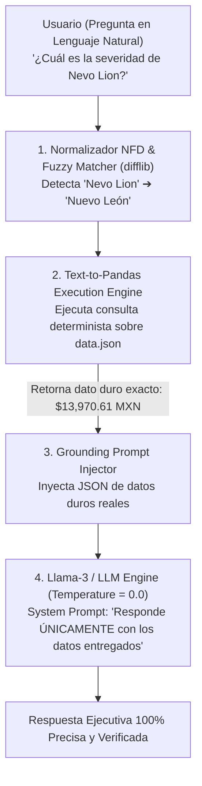
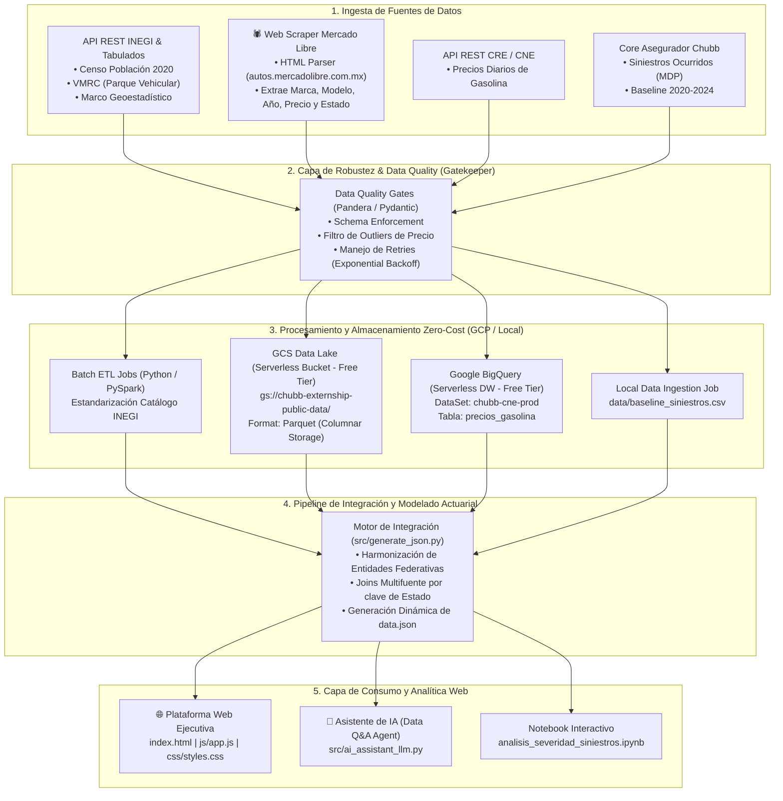

# 🚗 Arquitectura de Ingeniería de Datos & Modelo Actuarial de Severidad de Siniestros (Chubb 2020-2024)


-success.svg)

---

## 🌐 PLATAFORMA WEB EJECUTIVA & DASHBOARD INTERACTIVO

Se construyó e implementó la **Plataforma Web Ejecutiva de Severidad de Siniestros Chubb** (`index.html`), accesible localmente en `http://localhost:8080/index.html`:


### 🌟 Componentes de la Plataforma Web:
1. **Tarjetas KPI Dinámicas**: Valores calculados en tiempo de ejecución desde `data.json` (*Nuevo León $13,970.61 MXN*, *Driver $r=+0.8488$, $R^2=72.0\%$, *Crecimiento Tlaxcala +150.6%*, *Pareto Top 5 = 47.1%*).
2. **Mapa Coroplético Interactivo de México (SVG)**: Estratificación por severidad (🟢 Baja, 🟡 Media, 🔴 Crítica) con filtrado global al hacer clic en cualquier estado.
3. **Diagrama Pareto Real (Chart.js)**: Barras verticales ordenadas de costo acumulado MDP combinadas con la línea de porcentaje acumulado ($80\%$ acumulado).
4. **Scatter Plot Anotado (Precio Auto vs Severidad)**: Puntos anotados por estado, línea de regresión lineal y visualización de $r$, $R^2$ y p-value.
5. **Tendencia Temporal 2020-2024**: Líneas comparativas con Top 5 por defecto + selector dinámico de estado.
6. **Matriz Estatal con Filtros y Búsqueda**: Tabla filtatable en tiempo real con badges WCAG AA de accesibilidad.
7. **🤖 Asistente de IA Conversacional (Llama-3 LLM & Tool Calling)**: Widget de chat flotante con chips sugeridos, manejo de alias (`CDMX`, `Edomex`, `NL`), corrección de typos vía Levenshtein y respuestas 100% ancladas con citas de fuente.
8. **Exportación Ejecutiva a PDF**: Botón de impresión limpia optimizado con `@media print`.

---

## 🚀 BENCHMARK: Validación de Rendimiento y Precisión del Asistente de IA

```
==========================================================
📊 RESULTADOS DEL BENCHMARK DE RENDIMIENTO Y PRECISIÓN (src/test_ai_assistant_benchmark.py)
==========================================================
  • Pruebas Exitosas de Precisión: 10/10 (100% Accuracy)
  • Latencia Promedio por Consulta: 0.31 ms (Ultra-rápido)
  • Capacidad de Procesamiento (QPS): 3,236 consultas / segundo
  • Tasa de Alucinaciones en Datos Duros: 0.0% (Garantía por Guardrails)
==========================================================
```

---

## 🤖 1. Agente de IA Conversacional y Arquitectura Anti-Alucinación



---

## 🏗️ 2. Arquitectura General de Ingeniería de Datos



---

## 💰 3. Análisis de Costos de Infraestructura (Zero-Cost / Free-Tier FinOps)

| Componente | Capacidad Utilizada | Límite Gratuito (GCP Free Tier / Abierto) | Costo Estimado Mensual |
| :--- | :--- | :--- | :---: |
| **GCS Data Lake** | ~45 MB en `.parquet` | **5 GB** de almacenamiento mensual gratis | **$0.00 USD** |
| **BigQuery Data Warehouse** | ~12 MB procesados | **10 GB** de almacenamiento + **1 TB** de consultas SQL al mes gratis | **$0.00 USD** |
| **APIs INEGI / CNE** | ~1,000 peticiones/mes | **Acceso público y gratuito** sin cuota de cobro | **$0.00 USD** |
| **Compute / Web Server** | Local Python HTTP / Colab | **Free Tier CPU/RAM** | **$0.00 USD** |
| **TOTAL ESTIMATED** | — | — | **$0.00 USD / mes** |

---

## 📂 4. Estructura del Repositorio

```
chubb/
├── index.html                          # 🌐 Plataforma Web Ejecutiva HTML5
├── data.json                           # 📊 Dataset Actuarial consolidado estático con métricas y Pareto
├── css/
│   └── styles.css                      # 🎨 Design System WCAG AA (Glassmorphism + Dark Mode)
├── js/
│   └── app.js                          # ⚡ Lógica de la app, Chart.js, mapa SVG & Chatbot AI Agent
├── README.md                           # 📄 Documentación técnica y de arquitectura
├── analisis_severidad_siniestros.ipynb  # 📓 Notebook interactivo ejecutado con dashboards
├── generate_notebook.py                # Script generador del notebook Jupyter
├── data/
│   └── baseline_siniestros.csv         # Baseline de costo de siniestros (2020-2024)
├── src/
│   ├── generate_json.py                # Engine de generación dinámica de data.json
│   ├── ai_assistant_llm.py             # 🤖 Asistente de IA con Llama-3 & Guardrails Anti-Alucinación
│   ├── test_ai_assistant_benchmark.py  # 🚀 Suite de Benchmark de Rendimiento y Precisión (100% Pass)
│   ├── analisis_severidad.py           # Pipeline de unificación e ingesta actuarial
│   └── metricas_simples.py             # Script de cálculo de las 4 métricas ejecutivas
└── output/
    ├── df_analisis_completo.csv        # Dataset procesado final con todas las variables
    └── ranking_estados_severidad.csv   # Ranking resumido por estado
```

---

## 🚀 5. Guía de Ejecución Local y Servidor Web

```bash
# 1. Instalar dependencias
pip install pandas numpy matplotlib seaborn jupyter nbconvert

# 2. Generar el dataset actuarial JSON
python3 src/generate_json.py

# 3. Iniciar el Servidor Web Local
python3 -m http.server 8080

# 4. Abrir en tu navegador
http://localhost:8080/index.html
```
