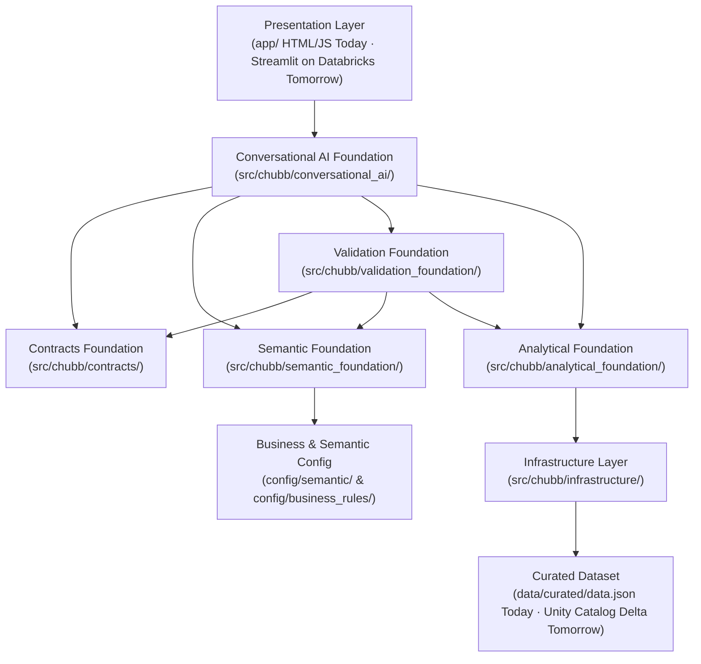

# Architecture Overview — CHUBB Modular Monolith with Four Foundations

## 1. Executive Summary

The **CHUBB Actuarial Analytics & Conversational AI** repository is structured as a **Modular Monolith** organized around four core Foundations, explicit cross-module contracts, and a storage-decoupled infrastructure layer.

---

## 2. The Four Foundations

| Foundation | Package Path | Core Responsibility | Architectural Restriction |
|---|---|---|---|
| **1. Semantic Foundation** | `src/chubb/semantic_foundation/` | Governs what data means: canonical entities, aliases, metrics, units, and temporal rules. | Never executes actuarial calculations or calls LLM providers. |
| **2. Analytical Foundation** | `src/chubb/analytical_foundation/` | Governs how results are computed: `ROUND_HALF_UP` math, rankings, Pareto, CAGR, executive summaries, and recommendations. | Operates 100% deterministically without any LLM or frontend dependency. |
| **3. Validation Foundation** | `src/chubb/validation_foundation/` | Governs reliability and auditability: schema validation, pre-execution `QueryIR` validation, result slot validation, and `S0` hallucination/label-swap guardrails. | Never silently alters analytical values. |
| **4. Conversational AI** | `src/chubb/conversational_ai/` | Governs natural language understanding, conversational memory, grounded response synthesis, and optional LLM providers. | Never calculates actuarial metrics directly; delegates all math to `Analytical Foundation`. |

---

## 3. Supporting Layers

- **Contracts (`src/chubb/contracts/`)**: Defines `QueryIR`, `AnalyticalResult`, `StructuredMetricSlot`, `ActuarialErrorContract`, and standardized `ErrorCode` constants.
- **Infrastructure (`src/chubb/infrastructure/`)**: Centralizes path resolution (`paths.py`) and storage adapters (`JsonDataRepository` in `json_repository.py`).
- **Backward-Compatibility Facades (`src/actuarial_core.py`, `src/llm_grounding.py`, `src/ai_assistant_llm.py`)**: Re-export all public classes and functions so legacy scripts, notebooks, and tests continue to work without modification.

